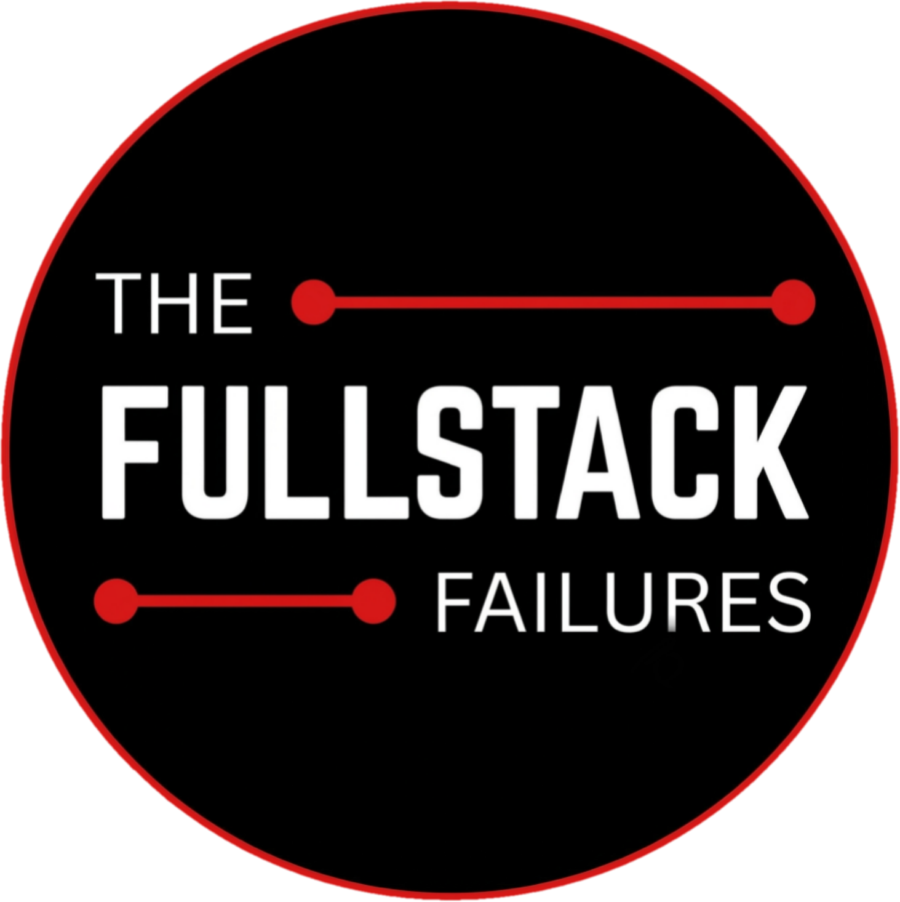

<div align="center">
  
  <h1>The Fullstack Failures · Our Products</h1>
  <p><strong>Useful stuff. Weird experiments. All made by us.</strong></p>
  <p>
    <a href="https://fullstackfailures.github.io/OurAllProducts/">Visit the live website</a>
    ·
    <a href="https://github.com/FullStackFailures">GitHub</a>
    ·
    <a href="https://instagram.com/the.fullstack.failures">Instagram</a>
  </p>
</div>

---

## About

**Our Products** is the public catalogue of projects built by **The Fullstack Failures**. It brings our websites, apps, experiments, and tools together in one place.

Browse the collection, search for a project, filter by category, and follow the links to open a website or view a release.

## Projects

| Project | What it is | Platform | Link |
|---|---|---|---|
| **ProblemsHub** | A community-style problem-sharing website. *For Builders, By Builders.* | Web | [Open ProblemsHub](https://problemshub.vercel.app/) |
| **Sus Among-Us** | A small Android app with the tagline “See a Sus report a Sus.” | Android | [View release](https://github.com/FullStackFailures/OurAllProducts/releases/tag/v1.0.0) |
| **Ransomware** | A Windows ransomware demonstration project. | Windows | [View release](https://github.com/FullStackFailures/OurAllProducts/releases/tag/ransomware.v1.0.0) |

> **Safety note:** The Ransomware project is a demonstration involving ransomware behaviour. Treat it as potentially harmful software. Do not run it on your everyday device, on production systems, or on any system you do not own or have explicit permission to test. Use an isolated, disposable lab environment only.

The catalogue is updated as projects are released. Product descriptions, versions, sizes, categories, and destination links are shown on the website.

## The website

- **Live URL:** https://fullstackfailures.github.io/OurAllProducts/
- **Repository:** https://github.com/FullStackFailures/OurAllProducts
- **Hosting:** GitHub Pages
- **Frontend:** HTML, CSS, and vanilla JavaScript
- **Product data:** JSON files in `data/`
- **Build step:** None required

The page is designed to work on phones, tablets, and desktop screens. It includes product search, category filters, project cards, and links to the relevant project pages or releases.

## For visitors

You can use the live website without a GitHub account.

1. Open the [Our Products website](https://fullstackfailures.github.io/OurAllProducts/).
2. Browse the product cards or use the search field.
3. Select a category to narrow the list.
4. Open a website or visit a project's release page.

For questions, feedback, or collaboration, find us on [GitHub](https://github.com/FullStackFailures) or [Instagram](https://instagram.com/the.fullstack.failures).

---

<details>
<summary><strong>Maintainer guide · Repository owner</strong></summary>

This section is for the people maintaining the repository. It is included for convenience, not access control: anyone who can view this public repository can also view the instructions below.

### Repository layout

| Path | Purpose |
|---|---|
| `index.html` | Main page structure and page metadata |
| `assets/style.css` | Layout, colors, responsive rules, and visual styling |
| `assets/app.js` | Loads the JSON data and renders product cards, search, and filters |
| `assets/logo.png` | Site logo |
| `assets/icons/` | Product icons |
| `assets/fonts/` | Locally hosted fonts |
| `assets/og.png` | Social sharing preview image |
| `data/products.json` | Product catalogue and category definitions |
| `data/site.json` | Site-level name and footer data |
| `.github/workflows/static.yml` | GitHub Actions workflow that deploys the site to Pages |

### Add or update a product

Edit `data/products.json`. Add a product object inside the `products` array.

Example:

```json
{
  "title": "Example Project",
  "description": "A short description of the project.",
  "type": "website",
  "url": "https://example.com/",
  "price": "Free",
  "icon": "assets/icons/example.png",
  "tags": ["example", "web"]
}
```

Fields used by the current page:

| Field | Required? | Purpose |
|---|---|---|
| `title` | Yes | Product name |
| `type` | Yes | Category key from the `types` object |
| `url` | Recommended | Destination opened by the product card |
| `description` | Optional | Short product description |
| `icon` | Optional | Image path or full HTTP(S) image URL |
| `price` | Optional | Price label, such as `Free` |
| `version` | Optional | Version label, such as `v1.0` |
| `size` | Optional | Download size, such as `66 MB` |
| `tags` | Optional | Extra words included in product search |
| `new` | Optional | Set to `true` to show the “Just launched” badge |

### Add a category

The `types` object at the top of `data/products.json` defines category labels and card actions.

Example:

```json
"game": {
  "label": "Games",
  "action": "Play now"
}
```

Then set `"type": "game"` on the relevant product. The category filter is generated from the product types in the catalogue.

### Update site-level text

Edit `data/site.json`.

- `name` updates the document title.
- `footer` updates the footer text.

The current page's main headings, navigation labels, social links, and CTA copy are written in `index.html`.

### Add or replace product icons

1. Add the image to `assets/icons/`.
2. Set the product's `icon` field to its relative path, for example `assets/icons/example.png`.
3. Keep the image square where possible so it fits the product icon container.

### Test before publishing

The site fetches JSON files at runtime. Run it through a local web server instead of opening `index.html` directly.

```bash
python3 -m json.tool data/products.json
python3 -m json.tool data/site.json
python3 -m http.server 8000
```

Then open http://localhost:8000.

### Deploy to GitHub Pages

The workflow in `.github/workflows/static.yml`:

- Runs when commits are pushed to `main`.
- Can also be started manually from the repository's **Actions** tab.
- Uploads the repository root as the Pages artifact.
- Deploys the artifact to GitHub Pages.

Check the repository settings:

1. Open **Settings → Pages**.
2. Set the build and deployment source to **GitHub Actions**.
3. Open **Actions** and confirm that **Deploy static content to Pages** completed successfully.

After a successful deployment, check the live site:

https://fullstackfailures.github.io/OurAllProducts/

### Commit changes

```bash
git add README.md data/products.json data/site.json assets/
git commit -m "Update product catalogue and documentation"
git push origin main
```

Only include the paths you changed. The deploy workflow will run after a push to `main`.

### Repository and website security

- Do not commit API keys, access tokens, passwords, private certificates, or personal data.
- Anything included in the public website must be treated as public, including JSON data, images, and downloadable links.
- A collapsed section in this README is not private. It only keeps the maintainer instructions out of the way for casual readers.
- Review new release files and links before adding them to the public catalogue.

</details>

---

<div align="center">
  <sub>Built and maintained by The Fullstack Failures.</sub>
</div>
