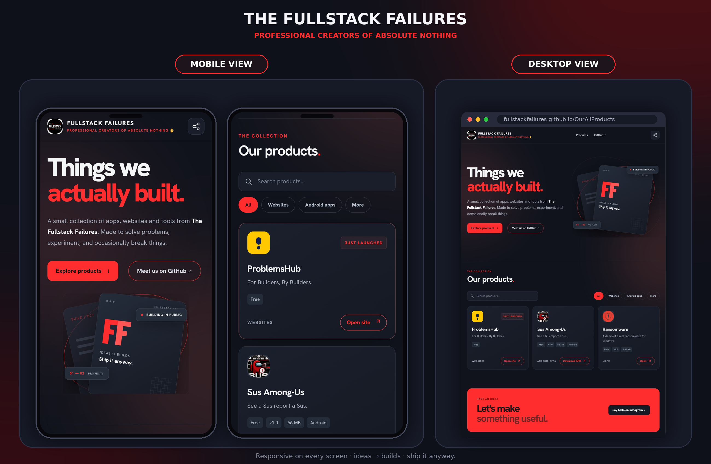

# The Fullstack Failures: link-in-bio hub

One page that lists every website, Android app, Windows app and tool we make. Built for the link in our Instagram bio. Free hosting on GitHub Pages, no build step, no frameworks.



## What it does

- Shows a big red logo lockup, a short bio and social links.
- Puts one product in a black **Start here** block at the top.
- Lists everything else by type (Websites, Android apps, Windows apps, Tools). The whole row is one big tap target.
- Shows price, version, size and platform on each row.
- Adds search and filter buttons by itself once you have enough products.
- Warns people who open it inside Instagram that downloads can fail there, and tells them how to fix it.
- Works on any phone, tablet or desktop. On a desktop the red panel stays on the left while the list scrolls.

Everything you change lives in the `data` folder. You never need to touch the code to add a product.

## 1. Upload to the repo (OurAllProducts)

Easiest: open https://github.com/FullStackFailures/OurAllProducts, click **Add file → Upload files**, drag in everything from this folder (include the `.github` folder and `.nojekyll`), then **Commit changes** on the `main` branch.

Or with git:

```
git init
git add .
git commit -m "Launch link hub"
git branch -M main
git remote add origin https://github.com/FullStackFailures/OurAllProducts.git
git push -u origin main
```

## 2. Turn on Pages

Repo **Settings → Pages → Build and deployment → Source: GitHub Actions**.
Open the **Actions** tab and wait for "Deploy static content to Pages" to go green (about a minute).

## 3. Your link

- With the repo named `OurAllProducts`: https://fullstackfailures.github.io/OurAllProducts/
- Cleaner link: rename the repo to `FullStackFailures.github.io` (Settings → General → Repository name). The link becomes https://fullstackfailures.github.io/ . Push again or re-run the Action after renaming. Then update the link preview address (see below).

Put that link in the Instagram bio, not the github.com repo link.

## Add a product

Edit `data/products.json` on GitHub (pencil icon), copy a product block, change it, commit. It goes live in about a minute.

| Field | Meaning |
|---|---|
| `title`, `description` | What people see. `description` is optional. |
| `type` | `website`, `apk`, `exe`, `tool`, `other`, or a type you add |
| `url` | Link to the site or file |
| `price` | Optional, for example `"Free"` or `"₹499"` |
| `version`, `size` | Optional |
| `icon` | Optional. An image path such as `assets/icons/myapp.png`, or an emoji. Without it, a drawn icon for the type is used. |
| `tags` | Optional search words |
| `featured` | `true` puts it in the big **Start here** block. Use it on one product. A featured product is not repeated in the list below. |
| `new` | `true` shows a red New badge |

### Types

Each type under `"types"` has a `label` (group heading), an `action` (button text), and optionally a `platform` (shown as a small tag, like `"Android"`).

To add a new category, add it under `"types"`:

```json
"game": { "label": "Games", "action": "Play now", "icon": "🎮" }
```

For your own types, `icon` is the emoji shown when a product has no icon of its own. The five built-in types use drawn icons instead.

### Search and filters

They hide themselves when they would only add clutter: the type buttons appear once you have 4 or more products in the list (not counting the featured one), and the search box appears at 6 or more. To change this, edit `SEARCH_MIN` and `CHIPS_MIN` near the top of the products section in `assets/app.js`.

## APK and EXE files

Repo **Releases → Draft a new release →** attach the file. Latest-file link:

`https://github.com/FullStackFailures/OurAllProducts/releases/latest/download/FILENAME`

(Releases allow 2 GB per file. Files inside the repo max 100 MB.)

Instagram's built-in browser often blocks downloads. When the page is opened from Instagram and you have an APK or EXE listed, a note appears telling people to tap the three dots and choose **Open in browser**. Nothing to set up.

## Edit your profile

`data/site.json` holds the name, handle, bio, social links and footer.

- **Logo lockup.** If `name` is three words, they become the big lockup: first word small, middle word huge, last word small, with the red-dot lines. To use different words, add `"lockup": ["The", "Fullstack", "Failures"]`. Any other number of words shows as plain big text.
- **Bio punchline.** Anything after `//` in `bio` goes on its own line, like a code comment.
- **Socials.** Each item needs `label` and `url`. GitHub and Instagram get their own icon. Everything else gets a link icon.

## Link preview image

When someone shares the link on WhatsApp, X or iMessage, the picture comes from `assets/og.png` (1200 × 630). Replace that file to change it.

Preview images need a full web address. `index.html` uses `https://fullstackfailures.github.io/OurAllProducts/assets/og.png` in two places (`og:image` and `twitter:image`). If your page address is different, change those two lines.

## Change the look

Colours and fonts are at the top of `assets/style.css`:

```css
--red:#FA0300;   /* the red from the logo */
--black:#000;
--white:#fff;
```

Fonts (Barlow Condensed and Hanken Grotesk) are saved in `assets/fonts`, so the page makes no calls to Google and loads fast inside Instagram.

## What is in the folder

| Path | What it is |
|---|---|
| `index.html` | The page |
| `assets/style.css`, `assets/app.js` | Look and behaviour |
| `assets/fonts/` | Self-hosted fonts |
| `assets/og.png` | Link preview image |
| `assets/favicon-192.png`, `apple-touch-icon.png` | Browser and home-screen icons |
| `assets/logo.png` | Original logo |
| `assets/icons/` | Product icons |
| `data/site.json`, `data/products.json` | Everything you edit |
| `.github/workflows/static.yml` | Publishes the site when you push |

## Test locally

`python -m http.server`, then open http://localhost:8000
(Opening `index.html` by double-click will not work, because the page reads the files in `data`.)

## Before you launch

`data/products.json` still contains two example products ("My Android App" and "My Windows Tool"). Their download links do not point to real files yet. Replace them with your own, or delete them.
